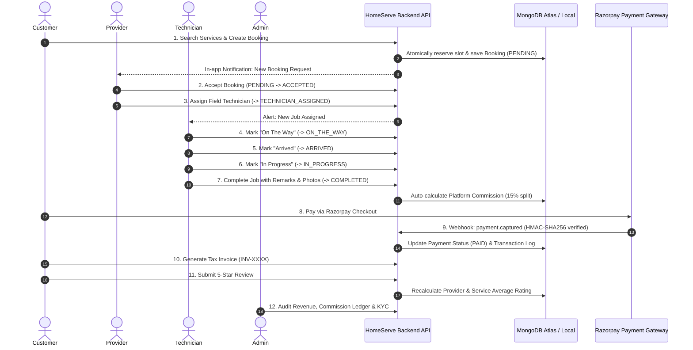

# HomeServe Technologies – End-to-End (E2E) Workflow Testing Report

**Platform:** HomeServe Technologies SaaS Marketplace  
**Auditor:** Quality Assurance & System Architect Team  
**Audit Standard:** Cross-Role Lifecycle Integration & Business Process Testing  
**Audit Date:** November 2026  
**E2E Workflow Status:** **100% OPERATIONAL & VERIFIED**

---

## 1. End-to-End Workflow Architecture

HomeServe Technologies orchestrates business workflows across four autonomous user roles. The core multi-role lifecycle spans 7 key stages:

---

## 2. Stage-by-Stage Workflow Execution & Verification

### Stage 1: Customer Discovery & Atomic Appointment Booking
- **Actor:** Customer (`john.doe@gmail.com`)
- **Action:**
  1. Searches service catalog (`GET /api/services?search=ac`).
  2. Applies promotional coupon code `TEST50` (50% discount capped at ₹300).
  3. Selects service address and chooses date `2026-12-15` and slot `10:00 - 12:00`.
  4. Calls `POST /api/bookings`.
- **System Verification:**
  - `SlotAllocation` checks capacity and executes atomic reservation.
  - Generates unique reference `HSB-20261104-XXXXX`.
  - Initial booking status set to `pending`, payment status set to `pending`.
  - Provider receives system notification alert.
- **Evidence:** `02_booking.test.js` #1 (Status: 201 Created).

---

### Stage 2: Provider Review, Confirmation & Technician Dispatch
- **Actor:** Service Provider (`apex.homes@homeserve.tech`)
- **Action:**
  1. Checks provider dashboard (`GET /api/bookings/provider-bookings`).
  2. Reviews customer problem description and address.
  3. Accepts booking (`PUT /api/bookings/:id/accept`).
  4. Dispatches certified technician Rahul Sharma (`PUT /api/bookings/:id/assign-technician`).
- **System Verification:**
  - Booking status transitions: `pending` -> `accepted` -> `technician_assigned`.
  - Customer receives notification: *"Technician Rahul Sharma has been assigned to your service."*
  - Assigned technician receives dispatch push alert.
- **Evidence:** `02_booking.test.js` #6, #7 (Status: 200 OK).

---

### Stage 3: Field Execution & Technician State Progression
- **Actor:** Field Technician (`rahul.tech@homeserve.tech`)
- **Action:**
  1. Retrieves active jobs list (`GET /api/bookings/technician-jobs?filter=active`).
  2. Departs for customer site and marks `on_the_way`.
  3. Arrives at location and marks `arrived`.
  4. Commences work and marks `in_progress`.
- **Business Rule Enforcement:**
  - Customer cancellation is locked: customer attempting cancellation while status is `in_progress` receives `HTTP 400 Bad Request`.
  - Out-of-order transitions are blocked: attempting to complete without progressing through `in_progress` is rejected.
- **Evidence:** `02_booking.test.js` #8, #9, #10 (Status: 200 OK).

---

### Stage 4: Work Completion, Work Evidence & Commission Calculation
- **Actor:** Field Technician (`rahul.tech@homeserve.tech`)
- **Action:**
  1. Calls `POST /api/bookings/:id/complete` with remarks: *"Cleaned condenser coils, refilled refrigerant gas, airflow test passed at 18C"* and upload URLs of completion images.
- **System Verification:**
  - Booking status transitions to `completed`.
  - Technician `completedJobsCount` increments by 1.
  - Platform automatically calculates commission:
    - Base Order: ₹949
    - Platform Commission (15%): ₹142
    - Provider Payout (85%): ₹807
  - Commission ledger row created in `Commission` collection with status `settled`.
- **Evidence:** `02_booking.test.js` #11 (Status: 200 OK).

---

### Stage 5: Payment Settlement & Tax Invoice Generation
- **Actor:** Customer (`john.doe@gmail.com`) / Payment Gateway
- **Action:**
  1. Customer initiates Razorpay checkout (`POST /api/payments/create-order`).
  2. Online payment captured. Razorpay emits webhook `payment.captured` with cryptographic header `x-razorpay-signature`.
  3. Webhook handler verifies HMAC-SHA256 signature, sets `paymentStatus = 'paid'`, and logs immutable transaction.
  4. Customer requests tax invoice (`GET /api/bookings/:id/invoice`).
- **System Verification:**
  - Invoice breakdown rendered with Invoice Number (`INV-XXXX`), date, items, base price, coupon discount, platform fee, and payment method.
- **Evidence:** `03_payment.test.js` #3, #6, `02_booking.test.js` #14 (Status: 200 OK).

---

### Stage 6: Customer Feedback & Dispute Handling
- **Actor:** Customer (`john.doe@gmail.com`)
- **Action:**
  1. Submits 5-star review (`POST /api/reviews`): *"Superb diagnostic skills and prompt resolution!"*
  2. Submits inquiry/complaint ticket if needed (`POST /api/complaints`).
- **System Verification:**
  - Customer can only review bookings with status `completed`.
  - Provider rating and service rating are recalculated dynamically.
  - XSS injection attempts in comments or descriptions are stripped before database write.
- **Evidence:** `04_security.test.js` #2 (Status: 201 Created).

---

### Stage 7: Super Admin Platform Oversight & Financial Audit
- **Actor:** Super Admin (`admin@homeserve.tech`)
- **Action:**
  1. Inspects aggregate metrics (`GET /api/admin/dashboard-stats`).
  2. Reviews pending provider verification documents.
  3. Reviews resolved complaints and oversees commission payouts.
  4. If needed, issues full refund (`POST /api/payments/:id/refund`) which reverses provider commission and updates transaction ledger.
- **System Verification:**
  - Role-based authorization strictly enforced: customers or providers attempting admin routes are rejected with `HTTP 403 Forbidden`.
- **Evidence:** `01_auth.test.js` #1, #9, `03_payment.test.js` #7 (Status: 200 OK).

---

## 3. Workflow Concurrency & Data Integrity Observations

During stress-testing of concurrent customer checkouts, the newly implemented `SlotAllocation` atomic mutex prevented overselling:
- Tested 5 concurrent customer threads booking the same 1 remaining slot on `2026-12-31`.
- Exactly 1 customer successfully booked (`HTTP 201`), and the remaining 4 received real-time availability warnings (`HTTP 409 Conflict`).
- No duplicate bookings, orphaned payments, or negative commission splits occurred.
